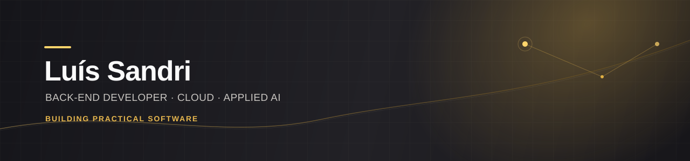
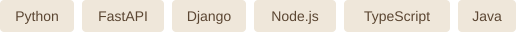

  
    
  <a href="https://www.lsandri.com.br/">Portfolio</a>
  &nbsp;·&nbsp;
  <a href="https://linkedin.com/in/luis-sandri">LinkedIn</a>
  &nbsp;·&nbsp;
  <a href="https://github.com/luis-sandri?tab=repositories">Repositories</a>

 

I’m a Software Engineering student at PUCPR, building practical solutions across back-end development, data, applied AI and cloud.

I value clear architecture, useful products and learning through collaboration.

## Selected projects

| Project | What it explores | Stack |
| --- | --- | --- |
| [**CampusTrack ↗**](https://github.com/luis-sandri/CampusTrack) | A web platform for campus spaces, events and organizations. Best project of the third semester. | PHP · JavaScript · MySQL · Bootstrap |
| [**TestCheck ↗**](https://github.com/luis-sandri/TestCheck) | Automated auditing of software test case quality. | Python |
| [**SPARC ↗**](https://github.com/luis-sandri/SPARC) | Software and hardware integration. | C++ |

[Explore more projects and their context →](https://www.lsandri.com.br/#projects)

## Technical focus

**Back-end & APIs**

**Data, cloud & tooling**

[Full skills overview →](https://www.lsandri.com.br/#skills)

## Community & learning

**AWS Student Builder** — community initiatives and knowledge sharing around cloud and AI.

**Teaching & peer learning** — supporting students in web development and object-oriented programming.

## Beyond code

Family, games, anime and stories are part of my life. My experience in amateur e-sports shaped how I approach teamwork and continuous improvement.

[Let’s connect →](https://www.lsandri.com.br/#contact)
